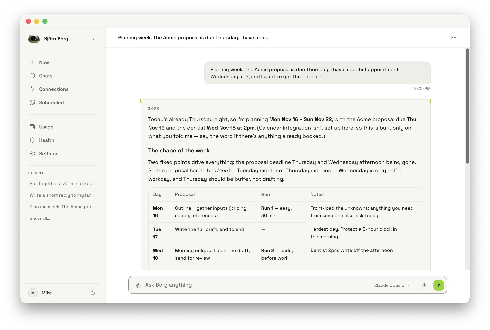

<p align="center">
  <a href="https://github.com/adelphidata/borg">
    
  </a>
</p>

<p align="center">
  Your personal AI assistant, employee, developer, analyst and sidekick. Security-first and open source.
</p>

<p align="center">
  Download for <a href="https://github.com/adelphidata/borg/releases/latest">Mac</a> · <a href="https://github.com/adelphidata/borg/releases/latest">Windows</a> · <a href="https://github.com/adelphidata/borg/releases/latest">Linux</a>
</p>

<p align="center">
  
</p>

<p align="center">
  Borg runs on your computer, learns how you work, and adapts.
</p>
<p></p>
<p align="center">
  <sub>macOS (Apple Silicon and Intel) · Windows 10+ (x64) · Linux (x64 and arm64 AppImage, x64 .deb)</sub><br><br>
  <a href="docs/">Docs</a> · <a href="docs/getting-started.md">Getting started</a> · <a href="CONTRIBUTING.md#development-setup">Build and run locally</a> · <a href="SECURITY.md">Security</a> · <a href="LICENSE">MIT license</a>
</p>

## What it does

- **One assistant, everywhere.** Borg runs as a background daemon with a desktop app, a terminal UI and a browser UI on top.
- **Writes its own tools.** Borg builds scripts at runtime instead of waiting for a plugin to exist.
- **Sandboxed by default.** Every tool runs inside macOS Seatbelt or Linux Bubblewrap with no network and no access to your secrets.
- **Any model.** Use Anthropic, OpenAI, Gemini, OpenRouter, Bedrock, Azure, Vertex AI, DeepSeek, Groq, xAI, your Claude Code subscription, or Ollama for fully local.
- **Remembers.** Borg keeps working memory, curated Markdown notes and long-term memory, and recalls them by relevance.
- **Reaches you where you are.** Chat over Telegram, Slack, Discord, Teams, Google Chat, Signal, WhatsApp, SMS and iMessage.
- **Works while you sleep.** Scheduled prompts, cron jobs and proactive heartbeat check-ins run from the daemon.
- **Connects your apps.** Gmail, Outlook, Google Calendar, Notion and Linear plug in from the app, and any MCP server adds more tools.
- **Skills.** Built-in skills teach Borg how to use the CLI tools you already have, and you can write your own.
- **Meeting notes.** Borg records your calls, transcribes them and writes up the notes, with no bot in the meeting.
- **Voice and phone.** Talk to Borg, have replies read aloud, and let it place calls.
- **Computer use.** Borg can look at your screen and click through native apps when you ask it to.
- **Heals itself.** Daily maintenance sweeps catch missed runs, stale state and host problems before you do.

<!--
## Watch the demo

https://github.com/user-attachments/assets/placeholder
-->

## How it works

1. **Install.** Download the app for your platform, or install the CLI with one command.
2. **Set up.** A short wizard asks for your name, a model provider and the channels you want. The desktop app starts the engine for you.
3. **Ask.** Type, talk or message Borg. It plans, writes the tool it needs, runs it in a sandbox and reports back.
4. **Let it run.** Close the window and Borg keeps going: schedules fire, heartbeats check in, channels stay connected.

Borg talks to the model provider you choose and nothing else. Point it at Ollama and it never leaves your computer.

```sh
curl -fsSL https://raw.githubusercontent.com/adelphidata/borg/main/scripts/install.sh | bash
borg
```

<details><summary>Where your memory, settings, scripts and database are stored</summary>

- Mac and Linux use `~/.borg`.
- Windows uses `%USERPROFILE%\.borg`.
- Set `BORG_HOME` to put it somewhere else.

</details>

## FAQ

<details><summary><strong>Where does my data go?</strong></summary>

<br>

> It stays in `~/.borg` on your computer: memory, settings, scripts and a SQLite database with owner-only permissions. The only outbound traffic is to the model provider you picked, the services you connect, and GitHub for update checks. There is no account and no analytics.

</details>

<details><summary><strong>Does Borg work offline?</strong></summary>

<br>

> Yes, with a local model. Point Borg at Ollama or a llama.cpp server and chat, memory, skills and scheduling all run on your computer. Speech and voice can run locally too. Channels like Telegram need the internet by nature.

</details>

<details><summary><strong>Can I move from another assistant or agent?</strong></summary>

<br>

> Yes. Run `/migrate` to import memory and settings from another agent.

</details>

<details><summary><strong>Which models can I use?</strong></summary>

<br>

> Anthropic, OpenAI, Google Gemini, OpenRouter, AWS Bedrock, Azure OpenAI, Google Vertex AI, DeepSeek, Groq and xAI with an API key. Claude Code uses your existing subscription with no key. Ollama or any OpenAI-compatible local server runs with no key at all. Switch any time with `/model`.

</details>

<details><summary><strong>What are Borg's built-in security features?</strong></summary>

<br>

> Every tool runs in a sandbox: Seatbelt on macOS, Bubblewrap on Linux. Network is off unless a tool asks for it. `~/.borg`, `.ssh`, `.aws`, `.gnupg` and other sensitive paths are blocked. Scripts Borg writes are HMAC-sealed so a tampered file won't run. Secrets are redacted from tool output and from everything Borg sends out. Prompt injection scoring flags suspicious input, per-session rate limits cap tool calls and shell commands, and a URL classifier gates every web fetch. Credentials live in your OS keychain and the database is owner-only. See [SECURITY.md](SECURITY.md) for the full list.

</details>

<details><summary><strong>How does Borg keep its tools from doing damage?</strong></summary>

<br>

> Each tool declares what it needs: network, which paths it can read, which it can write. Everything else is denied by the sandbox before the tool starts. Borg's own config, memory and scripts are always write-protected, so a tool cannot change the agent that runs it.

</details>

<details><summary><strong>What is auto-healing?</strong></summary>

<br>

> Borg is built to run unattended for weeks. A daily maintenance sweep repairs missing folders, runs the same diagnostics as `borg doctor`, rotates logs, prunes old data, and reschedules tasks that stalled while your laptop was asleep. It costs zero tokens and runs even without a model key. Run `/heal` to do a sweep on demand.

</details>

<details><summary><strong>What stops someone else from messaging my Borg?</strong></summary>

<br>

> Unknown senders on any channel must be paired before Borg processes a word. Credentials for each channel live in your OS keychain. The gateway listens on localhost unless you tell it otherwise.

</details>

<details><summary><strong>Which chat apps does Borg work with?</strong></summary>

<br>

> Telegram, Slack, Discord, Microsoft Teams, Google Chat, Signal, and WhatsApp and SMS through Twilio. iMessage works automatically on macOS. Add them with `/plugins` or during setup.

</details>

<details><summary><strong>Can Borg use MCP servers?</strong></summary>

<br>

> Yes. Register a server with `borg mcp add` over stdio, streamable HTTP or SSE, and its tools show up to the model like any other. See [docs/mcp.md](docs/mcp.md).

</details>

<details><summary><strong>Do I need the CLI to use the desktop app?</strong></summary>

<br>

> No. The desktop app ships with the Borg engine and starts it on launch. Install the CLI too if you want the terminal UI, `borg service install` to keep the engine running at login, or scripting from your shell.

</details>

<details><summary><strong>What kind of computer do I need?</strong></summary>

<br>

> A Mac with Apple silicon or Intel, a 64-bit PC with Windows 10 or newer, or a 64-bit Linux computer (x64 or arm64). On Linux, install `bubblewrap` from your package manager so tools can run sandboxed. macOS has everything built in.

</details>

<details><summary><strong>How do I update?</strong></summary>

<br>

> The desktop app checks GitHub Releases and updates itself. The CLI updates with `borg update`, or `borg update --check` to see what's new first.

</details>

## Build from source

See [CONTRIBUTING.md](CONTRIBUTING.md) for setup, tests and installer builds.

## License

[MIT](LICENSE) · Copyright 2026 Adelphi Data.
